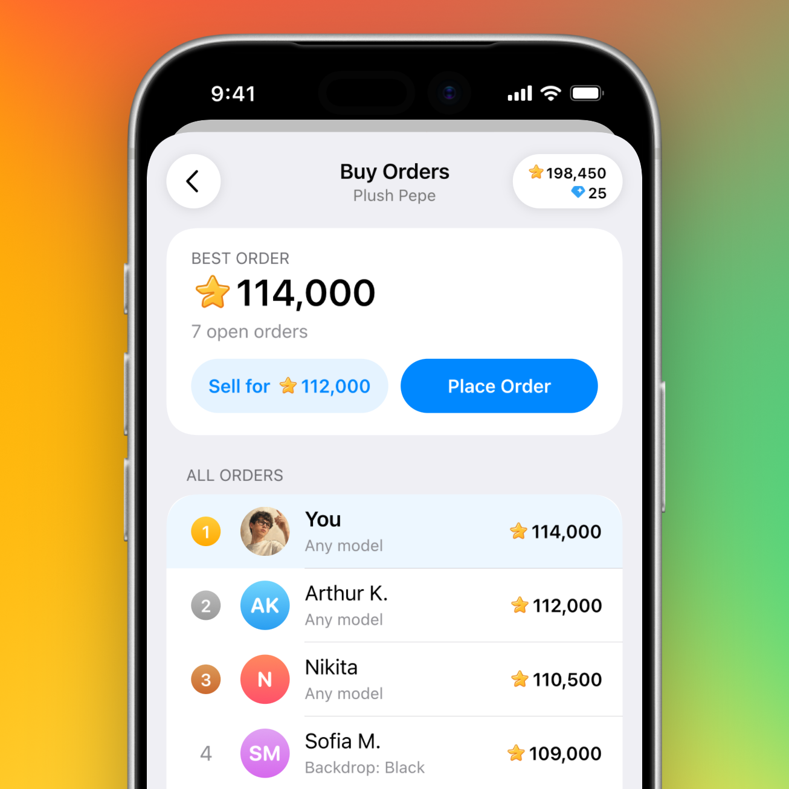

# Buy Orders for Telegram iOS

Name your price for any gift in a collection. On the gift market, the first cell of a collection is now Buy Orders — its order book: place an order at your price and the gift is yours as soon as someone sells, or sell a gift you own to the best order in one tap.

[](Media/demo.mp4)

▶︎ [Media/demo.mp4](Media/demo.mp4) — the concept, animated (24 s).

## Why

The resale market only works one way: sellers list a gift and buyers pick from the listings. If you want a gift of a collection but not at today's cheapest price, all you can do is come back and check. And if you own one and want to sell now, you list it and wait for someone to come.

Buy orders add the other side of the market. Buyers say what they would pay, sellers see the best price waiting for them, and a trade happens the moment both sides meet.

## What it does

- **Buy Orders cell.** The first cell of a collection's market shows the buyers' avatars, how many orders are open and the best one, in the shop's own price capsule.
- **Order book.** A tap opens the collection's orders: the best order, the count, **Sell for ★N** and **Place Order**, then every order with its place, buyer, condition ("Any model", "Backdrop: Black") and price.
- **Place Order.** The "Offer to Buy" sheet in its order shape: Stars or GRAM, the price per gift, how long the order stays open (48 hours by default). Your Stars are held while it is open; the order goes into the book — at the top if it is the best.
- **Sell.** If you own a gift of the collection, Sell opens Telegram's sale confirmation with the gift, the buyer, the price and what you receive after fees. Confirming sells it to the best order.
- **Your orders.** Your balance shows what your open orders hold; tap your own order to cancel it.

## How it works

| Piece | Where |
| --- | --- |
| The order book: sample buyers, your orders, storage | `GiftBuyOrders.swift` (new) |
| The first cell of a collection's market | `GiftBuyOrdersCellComponent.swift` (new) |
| The orders screen: summary card and rows | `GiftBuyOrdersScreen.swift` (new) |
| The cell in the market's grid | `GiftStoreScreen.swift` |
| The balance without what your orders hold | `BalanceComponent.swift` |
| The Buy Order sheet | `StarsWithdrawalScreen.swift` (new mode `.starGiftBuyOrder`) |

- **Market.** The Buy Orders cell takes the first slot of the collection's grid in `GiftStoreScreen`, in the grid's own cell size, with the shop's price capsule and ribbon.
- **Placing an order.** A new mode of the app's "Offer to Buy" sheet: the same price field, limits, duration menu and number pad, worded as an order and spanning the full width. If the balance is short, the app's own Stars purchase screen opens, as it does for an offer.
- **Selling.** Telegram's sale confirmation (the one used to accept an offer) with your gift of the collection, the buyer and the amount after fees; confirming shows a toast.
- **Storage.** Each collection gets six sample buyers, priced just under its cheapest listing and the same every time. Your own orders are kept in `UserDefaults` per account and gift and expire after their duration. A production version would keep the book on the server, hold the Stars there, and match orders with listings as they appear.

## Repository

| Path | What |
| --- | --- |
| `changes.patch` | The whole feature as one patch for Telegram-iOS: 7 files, +1936 −18 |
| `Sources/GiftStoreScreen/` | The new files from the patch, for reading: `GiftBuyOrders.swift`, `GiftBuyOrdersCellComponent.swift`, `GiftBuyOrdersScreen.swift` |
| `Media/demo.mp4` | The concept, animated |

## Changes

| File | Change |
| --- | --- |
| `submodules/TelegramUI/Components/Gifts/GiftStoreScreen/Sources/GiftBuyOrders.swift` | New: the order book and its storage |
| `submodules/TelegramUI/Components/Gifts/GiftStoreScreen/Sources/GiftBuyOrdersCellComponent.swift` | New: the Buy Orders cell |
| `submodules/TelegramUI/Components/Gifts/GiftStoreScreen/Sources/GiftBuyOrdersScreen.swift` | New: the orders screen |
| `submodules/TelegramUI/Components/Gifts/GiftStoreScreen/Sources/GiftStoreScreen.swift` | The cell first in the grid |
| `submodules/TelegramUI/Components/Gifts/GiftStoreScreen/Sources/BalanceComponent.swift` | The balance shows what your orders hold |
| `submodules/TelegramUI/Components/Gifts/GiftStoreScreen/BUILD` | Four dependencies for the new files |
| `submodules/TelegramUI/Components/Stars/StarsWithdrawalScreen/Sources/StarsWithdrawalScreen.swift` | A buy-order mode of the offer sheet, full width |

## Trying it

This is a change to the Telegram-iOS source tree, not a standalone app. Apply the patch to a checkout of [TelegramMessenger/Telegram-iOS](https://github.com/TelegramMessenger/Telegram-iOS) (made against `master` at `24638bc69b`, 2026-11-03) and build the app as usual:

```sh
git apply changes.patch
```

Then open Settings → Send a Gift → yourself → Collectibles → any collection with listings, and tap the first cell.

## Limitations

- **No server side.** Telegram has no API for buy orders, so the book is client-side: sample orders for each collection plus the orders you place, kept on the device. Nothing is charged or sent — the balance only shows the held amount — and filling an order is not simulated in the app.
- **Selling is shown, not done.** Confirming a sale removes that buyer's order locally and shows a toast; no gift moves and no Stars arrive. If you own no gift of the collection, a listed gift stands in so the flow can be seen.
- **English only.** The new strings are in the code, not in `Localizable.strings`.
- **Not run on a device.** The app builds for the simulator with the patch; the screens were not checked on a screen or with a logged-in account.
- **The video is a concept.** It was animated from the app's own screens and numbers, not recorded from a running app; prices and people in it are invented.

## License

Telegram-iOS is distributed under the GNU General Public License v2.0, and so is this patch. See [LICENSE](LICENSE).
